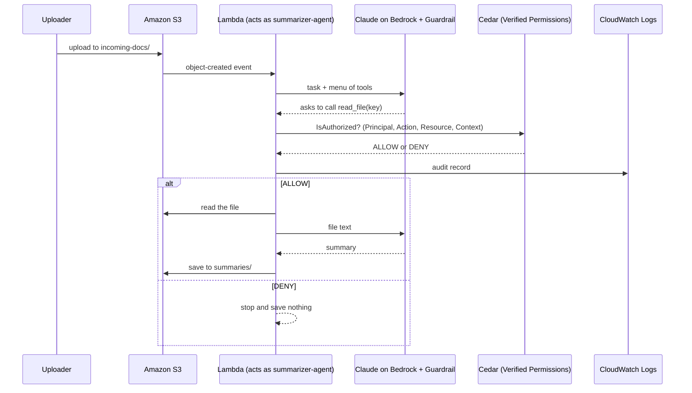

# Governing AI Agents as Identities

### Cedar-controlled tool calls on AWS: policy decoupled from code, every action authorized and audited

> **This project is not a tutorial on how to build an AI agent.**
> The agent here is deliberately small. The point is the layer around it: an AI agent is a **new kind of identity**, and like any identity it must be **authenticated, given only the authority it needs, and monitored**.

---

## The idea in one minute

Identity is the new perimeter. Staff, apps and data live in the cloud and are reached from anywhere, so access decisions hinge on *who or what is asking*, not on which network they sit in.

AI agents add a twist. They act on their own, using credentials, and they decide *at runtime* which action to take next. Each one is a **non-human identity** with real authority, and its behavior is not fully predictable.

This repository demonstrates one concrete way to govern that identity:

1. The agent is a **distinct principal** (`summarizer-agent`), not a shared admin role and not a pretend human.
2. The model can only *ask* to use a tool. **Cedar policies decide, per request, whether the tool call may run.**
3. The policy lives in **Amazon Verified Permissions, outside the application code**, so authority can change without redeploying anything.
4. Every decision is **logged**, so the agent's behavior can be investigated later.
5. A **guardrail** screens content going to and from the model.

## The problem this addresses

Teams adopting agents commonly fall into two traps:

| Trap | What it looks like | Why it hurts |
|---|---|---|
| **Too much permission** | The agent gets a broad role "so it just works", because nobody can predict everything it might try | One prompt injection or one bad decision can read, change or delete far more than intended |
| **Treated like a human identity** | Long-lived access, static role assignments, trust based on who owns it, no per-action decision | Humans are predictable and accountable. Agents are autonomous, non-deterministic and can be manipulated by the content they read |

A third problem sits underneath both: **nobody is watching**. If you cannot answer "what did this agent try to do, and what was it allowed to do?", you are not governing it.

## Why traditional IAM alone is not enough

Classic IAM grants a fixed set of permissions *in advance*. That works when you know what the workload will do. An agent's next action is chosen by a model at runtime, so a static grant is either too tight to be useful or too loose to be safe.

IAM is **not replaced**. It stays the base layer, limiting what the Lambda can touch at all. Cedar adds a **fine-grained, context-aware decision for each individual request** on top of it.

## What this project demonstrates

| Principle | How it shows up here |
|---|---|
| **AI is an identity** | `summarizer-agent` is its own principal in Cedar, separate from the Lambda's IAM role |
| **Least privilege** | One permitted action (`ReadFile`) on one bucket and one folder. Everything else is denied by default |
| **Zero trust** | Nothing the model asks for is trusted. The file path in a tool call is model-chosen, so Cedar checks the real bucket and folder every time |
| **Policy decoupled from code** | Authority lives in the policy store. During testing, a changed IP was fixed with a one-line policy edit and the Lambda code was never touched or redeployed |
| **Control at tool-call time** | Cedar sits between "the model wants to read a file" and "the file is read" |
| **Monitoring** | Each decision is written to CloudWatch as a JSON audit record |
| **Defense in depth** | IAM, Cedar and a guardrail each cover a different failure |

## Architecture



### Layers of defense

| Layer | Question it answers | Mechanism |
|---|---|---|
| IAM execution role | What can this Lambda touch at all? | Customer managed policy. No `s3:DeleteObject`, no wildcard resources for S3 |
| **Cedar policy** | **May this agent do *this* action on *this* resource, right now?** | **Verified Permissions, evaluated on every tool call** |
| Bedrock Guardrail | Is the content going in or out acceptable? | Blocks prompt injection in documents, masks sensitive data in summaries |
| CloudWatch Logs | What happened? | JSON audit record per decision |

## Cedar, mapped to PARC

| PARC | In this project |
|---|---|
| **P**rincipal | `AgentApp::Agent::"summarizer-agent"` |
| **A**ction | `AgentApp::Action::"ReadFile"` |
| **R**esource | `AgentApp::S3Object` with `bucket` and `folder` attributes |
| **C**ontext | `ip_address` of the uploader |

**Schema** (namespace `AgentApp`): entity types `Agent` and `S3Object` (attributes `bucket`, `folder`), actions `ReadFile` (context: `ip_address`) and `DeleteFile` (defined, never granted).

**Policy**

```cedar
permit (
    principal == AgentApp::Agent::"summarizer-agent",
    action == AgentApp::Action::"ReadFile",
    resource is AgentApp::S3Object
) when {
    resource.bucket == "<YOUR_BUCKET>" &&
    resource.folder == "incoming-docs" &&
    context.ip_address == "<ALLOWED_IP>"
};
```

Cedar denies by default. Anything without a matching `permit`, including `DeleteFile`, is refused.

## Evidence

| Scenario | Expected | Observed |
|---|---|---|
| Upload from the approved IP | ALLOW, summary saved | `"decision": "ALLOW"`, then "Summary saved" |
| Upload from a different IP | DENY, nothing saved | `"decision": "DENY"`, then "No summary saved" |
| `DeleteFile` request (Verified Permissions test bench) | DENY, no policy permits it | Denied |
| Document with a prompt-injection attempt | Guardrail intervenes | Tested, worked |

Sample audit record from a real run:

```json
{"agent": "summarizer-agent", "action": "ReadFile", "bucket": "<bucket>",
 "key": "incoming-docs/example.txt", "ip": "<source ip>", "decision": "DENY"}
```

Note: `DeleteFile` was verified in the test bench. It is not exposed to the model as a live tool in this version.

## Why Cedar instead of `if` statements in the Lambda

- **Separation of duties.** Developers write the agent. Security owns the policy. Neither needs the other to redeploy.
- **Auditable and reviewable.** Policies are readable, versionable text, validated against a schema in strict mode.
- **Consistent.** The same rules can govern many agents and applications instead of being re-implemented, and drifting, in each one.
- **Safer defaults.** Deny-by-default evaluation, and `forbid` always wins over `permit`.

## Stack

Python on AWS Lambda, Amazon Bedrock (Claude Haiku 4.5 via cross-region inference profile), Bedrock Guardrails, Amazon Verified Permissions (Cedar), Amazon S3 (event trigger on `incoming-docs/`), IAM, CloudWatch Logs.

## Setup

1. Create an S3 bucket with an `incoming-docs/` folder.
2. Create a Verified Permissions policy store (strict validation), add the schema, and create the policy above.
3. Enable the Anthropic model in Bedrock and create a guardrail. Note its ID and version.
4. Create the Lambda role with `AWSLambdaBasicExecutionRole` plus a customer managed policy allowing:
   - `s3:GetObject` on `arn:aws:s3:::<YOUR_BUCKET>/incoming-docs/*`
   - `s3:PutObject` on `arn:aws:s3:::<YOUR_BUCKET>/summaries/*`
   - `verifiedpermissions:IsAuthorized` on the policy store ARN
   - `bedrock:InvokeModel` and `bedrock:ApplyGuardrail` on the model, inference profile and guardrail ARNs
5. Create the Lambda (Python), upload `lambda_function.py`, set a timeout of about 2 minutes.
6. Set the environment variables below.
7. Add an S3 trigger: all object create events, prefix `incoming-docs/`.
8. Upload a small `.txt` file and check `summaries/` and CloudWatch Logs.

| Variable | Purpose |
|---|---|
| `POLICY_STORE_ID` | Verified Permissions policy store |
| `MODEL_ID` | e.g. `eu.anthropic.claude-haiku-4-5-20251001-v1:0` |
| `GUARDRAIL_ID` | Bedrock guardrail ID |
| `GUARDRAIL_VERSION` | Guardrail version number |

Summaries are written to `summaries/`, a prefix the trigger ignores, so the function cannot trigger itself in a loop.

## Honest scope and limitations

- **The IP condition is a demo.** Home IPs change, so a real deployment would use identity or role attributes instead.
- **One agent, one hardcoded principal.** Production would issue each agent its own identity and carry the end user's identity through to the decision.
- **Read path only.** The `DeleteFile` action is defined and denied, but no delete tool is wired up.
- **Plain text only.** `.docx` and `.pdf` files need an extraction step.
- **Guardrail interventions are not yet logged.** Cedar decisions are.
- **A guardrail is not a security boundary on its own.** That is why Cedar and IAM are there.

## Where this goes next

- Add a `delete_file` tool and show Cedar blocking a model-initiated delete.
- Policies that depend on document sensitivity or the requesting user, not just location.
- Ship audit logs to S3 and alert on repeated `DENY` records.
- Log guardrail interventions alongside Cedar decisions.

## Takeaway

Giving an agent access is a **governance decision**, not just a deployment step. Treat the agent as an identity, give it the least authority that works, decide on every action it attempts, and keep a record of what it did.

## Background reading

Books that shaped this project: *Authorization in Action* and *Securing AI Agents*. Also the Cedar documentation and the Amazon Verified Permissions documentation.
